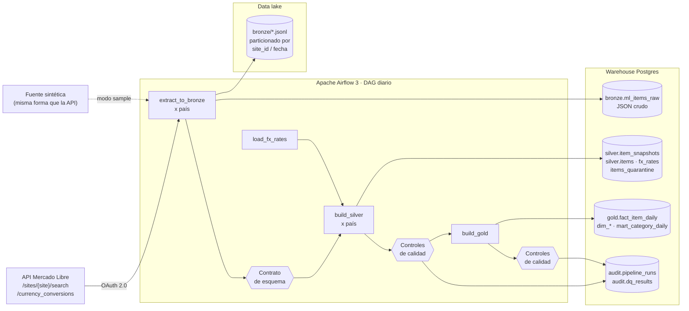

# Mercado Libre · Pipeline Medallion con Airflow y Docker


Pipeline de datos **end-to-end** que extrae publicaciones de **Mercado Libre** en
**Argentina, Brasil y México**, las procesa con **arquitectura Medallion**
(Bronze → Silver → Gold) y las deja listas para análisis: precios comparables en
**USD**, histórico diario y un **modelo estrella** con data marts.

> **Pregunta de negocio:** ¿cuánto cuesta lo mismo en cada país, en USD, y cómo
> evoluciona día a día?

---

## Arquitectura



| Capa | Qué contiene | Cómo se carga (idempotente) |
|------|--------------|-----------------------------|
| **Bronze** | JSON crudo tal cual llega, con duplicados y errores. Archivo en el lake + tabla. | *delete + insert* por partición `(fecha, país)` |
| **Silver** | Datos tipados, deduplicados, con moneda original **y** USD, tasa aplicada y cuarentena de rechazados. | `ROW_NUMBER()` + `MERGE` |
| **Gold** | Esquema estrella (`fact_item_daily` + 4 dimensiones) y `mart_category_daily` para BI. | *delete + insert* por fecha |

## Stack

**Python 3.12 · Apache Airflow 3.1 · PostgreSQL 16 · Docker Compose · pandas · SQL (MERGE, window functions) · pytest · GitHub Actions · VS Code**

## Inicio rápido

Requisitos: Docker Desktop (o Docker Engine + Compose), Python 3.11+ y `make`.
En Windows, usar WSL2.

```bash
git clone https://github.com/javieraltoe/ml-medallion-pipeline.git
cd ml-medallion-pipeline
make setup        # crea .env y el entorno virtual
make up           # levanta Airflow + warehouse (la primera vez tarda unos minutos)
```

1. Abrí **http://localhost:8080** → DAG `ml_medallion_daily` → activalo → ▶ *Trigger*.
2. Para tener histórico (lo usa el control de volumen): `make backfill`.
3. Mirá los datos: en VS Code, extensión **SQLTools** → conexión *Warehouse (Docker)* ya
   configurada → abrí `sql/analysis/consultas_demo.sql`.

Sin Docker, el mismo pipeline corre con la CLI (útil para depurar con breakpoints
desde VS Code, configuración *“Pipeline: correr un día”*):

```bash
python -m ml_pipeline run --date 2026-11-03
python -m ml_pipeline backfill --start 2026-10-20 --end 2026-11-03
```

## Fuente de datos: modo `sample` y modo `api`

Desde 2025 Mercado Libre **exige un token OAuth en todos sus endpoints**, incluida la búsqueda.
Por eso el pipeline tiene dos modos (variable `ML_SOURCE_MODE` en `.env`):

| Modo | Para qué | Requiere |
|------|----------|----------|
| `sample` (default) | Demo, CI, entrevistas. Genera datos **con la misma forma que la API**, determinísticos por fecha, con suciedad realista (duplicados, precios nulos, ítems en USD dentro de MLA, un campo nuevo que aparece un día). | Nada |
| `api` | Datos reales. | Una app en developers.mercadolibre.com → ver [`docs/mercadolibre_api.md`](docs/mercadolibre_api.md) |

El resto del pipeline no cambia entre modos: sólo cambia la función de extracción.

## Calidad de datos

Cada control es una consulta SQL que devuelve un número comparado contra un umbral. Los
resultados se guardan en `audit.dq_results`; si falla uno de severidad `error`, el DAG se
detiene y **no se publica Gold**.

| Dimensión | Control |
|-----------|---------|
| Contrato de esquema | Campos requeridos y tipos (`contracts/ml_search_item.json`). Campos nuevos → *warning*. |
| Unicidad | Una fila por publicación y día |
| Completitud | Todos los países llegaron · todo precio tiene USD |
| Validez | Precio > 0 · % en cuarentena ≤ 10% |
| Consistencia | Moneda = moneda local del sitio o USD |
| Reconciliación | Todo id de Bronze está en Silver o en cuarentena · Gold = Silver en filas **e importes** |
| Integridad referencial | Todo hecho apunta a dimensiones existentes |
| Volumen | Filas del día vs. promedio de 7 días (una caída > 50% falla) |
| Frescura | Tasa de cambio del mismo día |

**Para demostrarlo en vivo:**

```bash
make demo-volume-drop    # simula que el origen devuelve 80% menos filas -> falla el control de volumen
make demo-schema-break   # simula que la API deja de enviar "price"     -> falla el contrato
```

## Decisiones de diseño

- **Idempotencia en todas las capas.** Re-ejecutar un día o hacer backfill da exactamente
  el mismo resultado (lo verifica un test de integración).
- **Bronze guarda primero, valida después.** Si el origen cambia, se conserva la evidencia
  cruda pero no se contamina Silver.
- **Cuarentena en vez de descartar.** Los registros inválidos quedan en
  `silver.items_quarantine` con el motivo; la reconciliación garantiza que nada se pierde.
- **Moneda original + USD + tasa aplicada.** Nunca se suman importes en monedas distintas;
  la tasa usada queda guardada en cada fila para auditar.
- **Los controles de calidad no reintentan** (`retries=0`): un dato malo no se arregla
  reintentando. Las tareas de extracción sí (2 reintentos, 5 minutos).
- **El DAG sólo orquesta.** La lógica vive en `src/ml_pipeline` y se testea sin Airflow.
- **ELT en Gold.** Las agregaciones se hacen en SQL dentro del warehouse.
- **Linaje a nivel registro.** Cada fila lleva `_run_id`; Bronze guarda `source_file` y
  `payload_hash` (ver consulta 8 de `consultas_demo.sql`).

## Estructura

```
├── dags/ml_medallion_daily.py      # DAG: sólo orquestación
├── src/ml_pipeline/
│   ├── extract/                    # cliente API (OAuth, reintentos, paginación) + fuente sintética
│   ├── bronze.py · silver.py · gold.py
│   ├── transform/normalize.py      # pandas puro: aplanar, reglas, conversión a USD
│   ├── quality/                    # contratos de esquema + controles de calidad
│   └── __main__.py                 # CLI (mismo pipeline sin Airflow)
├── sql/ddl · sql/silver · sql/gold # SQL explícito (MERGE, ventanas, modelo estrella)
├── sql/analysis/consultas_demo.sql
├── contracts/ · seeds/
├── tests/unit · tests/integration · tests/test_dag_integrity.py
├── docs/                           # arquitectura, mapeo source-to-target, runbook, guía de entrevista
├── docker-compose.yml · Dockerfile · Makefile
└── .vscode/ · .github/workflows/ci.yml
```

## Tests y CI

```bash
make test               # unitarios (no necesitan Docker)
make test-integration   # end-to-end contra el warehouse: carga 8 días, re-ejecuta y verifica
                        # que nada cambie, y prueba los escenarios de falla
```

GitHub Actions corre: lint (ruff) → tests unitarios → test end-to-end con Postgres →
integridad del DAG con Airflow instalado → build de la imagen Docker.

## Documentación

- [Arquitectura y modelo de datos](docs/arquitectura.md)
- [Mapeo source-to-target](docs/source_to_target.md)
- [Runbook: qué hacer cuando algo falla](docs/runbook.md)
- [Cómo conectar la API real de Mercado Libre](docs/mercadolibre_api.md)
- [Cómo se llevaría a Databricks + Unity Catalog](docs/databricks.md)
- [Guía para presentarlo en una entrevista](docs/guia_entrevista.md)

## Próximos pasos

- Mover Bronze a almacenamiento de objetos (MinIO/S3) en formato Parquet/Delta.
- Transformaciones de Gold con dbt (tests y documentación de linaje automáticos).
- Alertas a Slack desde `on_failure_callback`.
- Dashboard en Metabase/Superset sobre `gold.mart_category_daily`.
