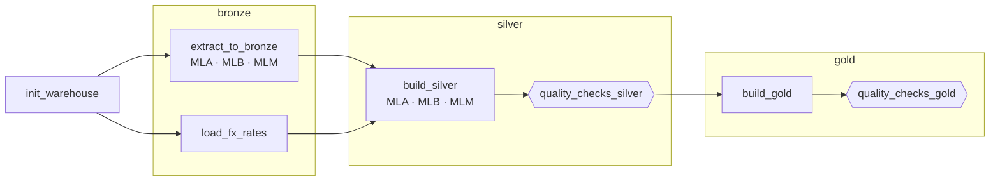
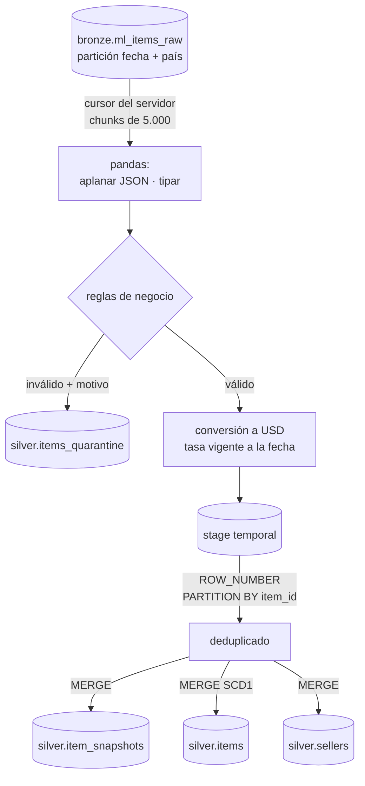
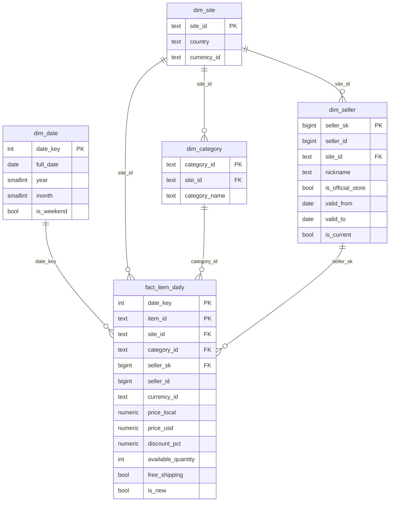

# Arquitectura y modelo de datos

## Flujo del DAG `ml_medallion_daily`

- **Schedule:** `@daily`, zona horaria `America/Argentina/Buenos_Aires`, `catchup=False`,
  `max_active_runs=1` (los días se procesan en orden; el control de volumen depende del histórico).
- **Reintentos:** 2, con 5 minutos de espera. Los controles de calidad tienen `retries=0`, y un
  cambio de esquema lanza `AirflowFailException` (falla sin reintentar).
- **Dynamic task mapping:** una tarea por país (`.expand(site_id=...)`). Agregar Chile es
  sumar `MLC` a `ML_SITES` y su moneda en `config.py`.
- **Fecha del snapshot:** se toma de `logical_date` (o `run_after` en ejecuciones manuales),
  convertida a hora de Argentina. Así un backfill del día 10 escribe la partición del día 10.

## Silver por dentro

La tabla de stage es `TEMP ... ON COMMIT DROP`: cada tarea en paralelo tiene la suya y todo
ocurre en una transacción (si algo falla, no queda nada a medias).

## Modelo estrella (Gold)

**Grano de la tabla de hechos:** una publicación por día. Las métricas (`price_usd`,
`available_quantity`, `discount_pct`) se agregan por cualquier dimensión.

`gold.mart_category_daily` es un mart desnormalizado (país × categoría × día) con media,
mediana, percentiles 25/75, % de envío gratis y descuento promedio.

## Dimensión vendedor: SCD tipo 2

`gold.dim_seller` guarda **una fila por versión** de cada vendedor. Cuando cambia un atributo
(nombre visible o condición de tienda oficial):

1. Se compara un `row_hash` de los atributos del día (`silver.seller_daily`) contra la versión vigente.
2. Si cambió, se **cierra** la versión vigente (`valid_to = día`, `is_current = false`).
3. Se **abre** una versión nueva (`valid_from = día`, `valid_to = 9999-12-31`, `is_current = true`).

| seller_id | seller_sk | nickname | is_official_store | valid_from | valid_to | is_current |
|---|---|---|---|---|---|---|
| 110875 | 7 | VENDEDOR_MLA_014 | false | 2026-10-21 | 2026-10-30 | false |
| 110875 | 151 | TIENDA_MLA_014 | false | 2026-10-30 | 9999-12-31 | true |

Los hechos guardan `seller_sk`, la versión **vigente el día del hecho** (*point-in-time*). Así,
un reporte del 29/10 muestra el nombre que tenía el vendedor ese día, no el actual.

Casos borde resueltos:
- **Re-ejecución del mismo día:** si la versión vigente empezó ese mismo día, se corrige en lugar
  de crear una versión de duración cero.
- **Re-ejecución de un día viejo:** no modifica la historia; los hechos de ese día apuntan a la
  versión que estaba vigente entonces.
- **Índice único parcial** `WHERE is_current`: la base de datos impide dos versiones vigentes.
- Controles de calidad: una versión vigente por vendedor, sin superposición de rangos, y cada
  hecho apunta a una versión válida en su fecha.

## Patrones de idempotencia usados

| Patrón | Dónde | Por qué ahí |
|--------|-------|-------------|
| Delete + insert por partición | Bronze, cuarentena, Gold | La partición se recalcula completa desde su fuente |
| `MERGE` por clave de negocio | Silver, tasas de cambio | Actualiza o inserta sin duplicar; preserva `first_seen_date` |
| `MERGE` con condición de fecha | `silver.items` (SCD1) | Un backfill de una fecha vieja no pisa el estado más nuevo |
| Expirar + insertar con hash | `gold.dim_seller` (SCD2) | Guarda la historia de cambios sin duplicar versiones al re-ejecutar |
| Archivo sobrescrito por partición | Data lake | Re-ejecutar reemplaza el archivo del día |

## Observabilidad

- `audit.pipeline_runs`: una fila por paso y país con filas de entrada/salida, duplicados
  removidos, motivos de rechazo y resultado del contrato (en `details` JSONB).
- `audit.dq_results` / `audit.vw_dq_latest`: historial de cada control.
- Logs de Airflow por tarea y `on_failure_callback` como punto único de alertas.
